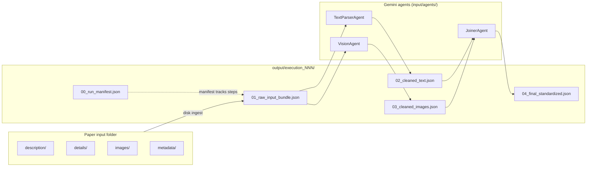

# AutoPaper pipeline (what actually runs)

**Package version:** 0.2.1 (keep in sync with `src/autopaper/__init__.py` and `pyproject.toml`)

**Source of truth:** `input/ingest.py` → `run_ingest_pipeline()`. When you change steps, filenames, or agents, update this document in the same change.

---

## Flow

---

## Steps

| Step | Artifact | Producer | Module |
|------|----------|----------|--------|
| 00 | `00_run_manifest.json` | `write_run_manifest` | `input/run_workspace.py` |
| 01 | `01_raw_input_bundle.json` | `load_raw_input_bundle` | `input/ingest.py` |
| 02 | `02_cleaned_text.json` | `TextParserAgent` | `input/agents/text_parser_agent.py` |
| 03 | `03_cleaned_images.json` | `VisionAgent` | `input/agents/vision_agent.py` |
| 04 | `04_final_standardized.json` | `JoinerAgent` | `input/agents/joiner_agent.py` |

**Input layout** (created if missing): `description/`, `details/`, `images/`, `metadata/` — see `input/layout.py`.

**Run directory:** `<repo>/output/execution_NNN/` by default; override with `AUTOPAPER_OUTPUT_DIR`, `run_ingest_pipeline(..., output_root=...)`, or CLI `--output-dir`.

---

## Entry points

| How | Where |
|-----|--------|
| CLI | `autopaper --input <paper-folder>` → `src/autopaper/main/app.py` |
| Python | `from input import run_ingest_pipeline` |

---

## Prompts (per agent)

| Agent | Prompt family (`input/prompts/`) |
|-------|----------------------------------|
| Text Parser | `gemini_text_parser/current.md` |
| Vision | `gemini_image_description/current.md` |
| Joiner | `gemini_joiner/current.md` |

Loaded via `input/prompts/loader.py`.

---

## Environment

| Variable | Purpose |
|----------|---------|
| `GOOGLE_API_KEY` or `GEMINI_API_KEY` | Required for steps 02–04 (set in repo `.env`) |
| `GEMINI_MODEL` | Required model id for the Gemini API (set in repo `.env`; no code fallback) |
| `AUTOPAPER_OUTPUT_DIR` | Base folder for `execution_NNN/` |

`input/agents/gemini_client.py` loads `<repo>/.env` on first use (existing shell env vars take precedence).

---

## Not in this pipeline yet

LaTeX export, remote A30 inference, plagiarism/citation checks, and full manuscript drafting are described in the repo root `README.MD` / `TASK_DESCRIPTION.md` but are **not** implemented in `run_ingest_pipeline()` today.

---

## Changelog (pipeline doc)

| Version | Change |
|---------|--------|
| 0.2.0 | Ingest + three Gemini agents; `GEMINI_MODEL` from `.env` only (no 1.5 fallback vars) |
| 0.2.1 | Gemini client uses `google-genai` SDK (replaces deprecated `google-generativeai`) |
| 0.2.2 | Vision/Joiner prompts v003/v002: visible-only figures, mismatch flags, no weak cross-links |
