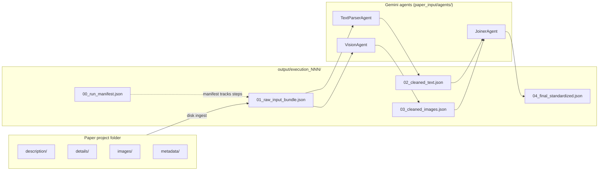

# Paper input rendering flow

**Mission:** Load a paper project folder (`description/`, `details/`, `images/`, `metadata/`), run Gemini agents, and write standardized JSON under `output/execution_NNN/`.

**Package:** `paper_input`  
**Source of truth:** `paper_input/ingest.py` → `run_ingest_pipeline()`. Update this doc when steps or artifacts change.

**Package version:** 0.3.0 (sync with `src/autopaper/__init__.py` and `pyproject.toml`)

---

## Flow

---

## Steps

| Step | Artifact | Producer | Module |
|------|----------|----------|--------|
| 00 | `00_run_manifest.json` | `write_run_manifest` | `paper_input/run_workspace.py` |
| 01 | `01_raw_input_bundle.json` | `load_raw_input_bundle` | `paper_input/ingest.py` |
| 02 | `02_cleaned_text.json` | `TextParserAgent` | `paper_input/agents/text_parser_agent.py` |
| 03 | `03_cleaned_images.json` | `VisionAgent` | `paper_input/agents/vision_agent.py` |
| 04 | `04_final_standardized.json` | `JoinerAgent` | `paper_input/agents/joiner_agent.py` |

**Run directory:** `<repo>/output/execution_NNN/` — override with `AUTOPAPER_OUTPUT_DIR`, `output_root=`, or `autopaper --output-dir`.

---

## Entry points

| How | Where |
|-----|--------|
| CLI | `autopaper --input <paper-folder>` |
| Python | `from paper_input import run_ingest_pipeline` |

---

## Prompts

| Agent | `paper_input/prompts/` family |
|-------|-------------------------------|
| Text Parser | `gemini_text_parser/current.md` |
| Vision | `gemini_image_description/current.md` |
| Joiner | `gemini_joiner/current.md` |

---

## Environment (per agent)

| Agent | API key | Model |
|-------|---------|-------|
| Text Parser | `PAPER_INPUT_TEXT_PARSER_API_KEY` | `PAPER_INPUT_TEXT_PARSER_MODEL` |
| Vision | `PAPER_INPUT_VISION_API_KEY` | `PAPER_INPUT_VISION_MODEL` |
| Joiner | `PAPER_INPUT_JOINER_API_KEY` | `PAPER_INPUT_JOINER_MODEL` |

Fallback: `GOOGLE_API_KEY` / `GEMINI_API_KEY`, `GEMINI_MODEL`. Pipeline: `AUTOPAPER_OUTPUT_DIR`.

---

## Changelog

| Version | Change |
|---------|--------|
| 0.3.0 | Package renamed `input` → `paper_input`; flow doc under `flow/paper_input/` |
| 0.2.2 | Vision/Joiner prompts: mismatch flags, visible-only figures |
| 0.2.1 | `google-genai` SDK |
| 0.2.0 | Three-agent ingest pipeline |
