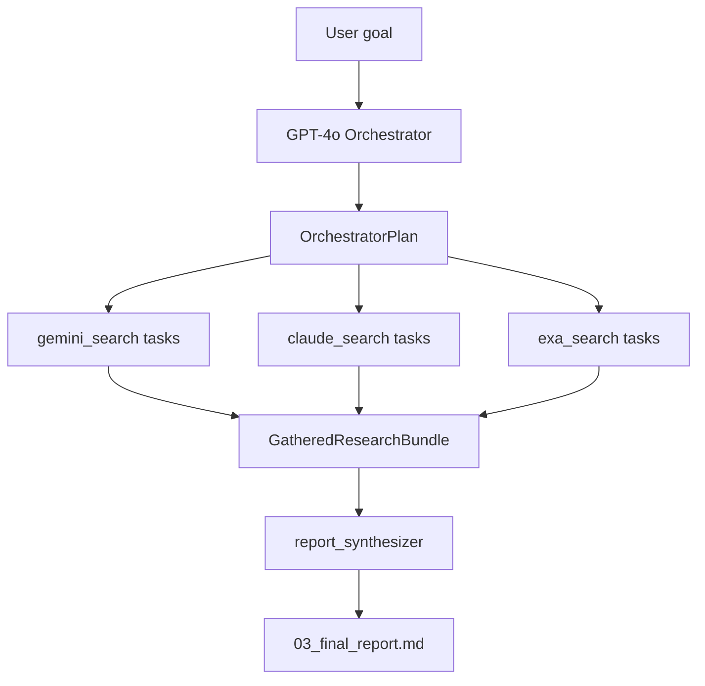

# Research flow

**Mission:** Multi-agent research — **three search agents in parallel** (Gemini, Claude, Exa), then a **report synthesizer** (Claude).

**Package:** `research`  
**Source of truth:** `research/pipeline.py` → `ResearchPipeline.run()`

---

## Flow



| Agent id | Provider | Role |
|----------|----------|------|
| `gemini_search` | Gemini | Subtopic research (model knowledge) |
| `claude_search` | Claude | Subtopic research (model knowledge) |
| `exa_search` | Exa API | Live web (`type=deep`, highlights) |
| `report_synthesizer` | Claude | Final Markdown report |

All search tasks run **in parallel** (`SearchCoordinator`).

---

## Entry points

```bash
research "Your research goal"
```

---

## Environment

One API key per provider in repo root `.env`; set a separate `*_MODEL` when an agent uses a different model.

| Provider | API key | Model variables |
|----------|---------|-----------------|
| Google (paper_input + gemini_search) | `GOOGLE_API_KEY` | `PAPER_INPUT_*_MODEL`, `RESEARCH_GEMINI_SEARCH_MODEL` |
| OpenAI (orchestrator) | `OPENAI_API_KEY` | `RESEARCH_ORCHESTRATOR_MODEL` |
| Anthropic (claude_search + synthesizer) | `ANTHROPIC_API_KEY` | `RESEARCH_CLAUDE_SEARCH_MODEL`, `RESEARCH_REPORT_SYNTHESIZER_MODEL` |
| Exa | `EXA_API_KEY` | `EXA_SEARCH_TYPE`, `EXA_NUM_RESULTS` |

Optional per-agent `RESEARCH_*_API_KEY` overrides still work. Do not commit `.env`.

---

## Changelog

| Version | Change |
|---------|--------|
| 1.2.0 | Three search agents: gemini_search, claude_search, exa_search + report_synthesizer |
| 1.1.0 | AI-only gatherer (no web scrape) |
| 1.0.0 | Initial research package |
