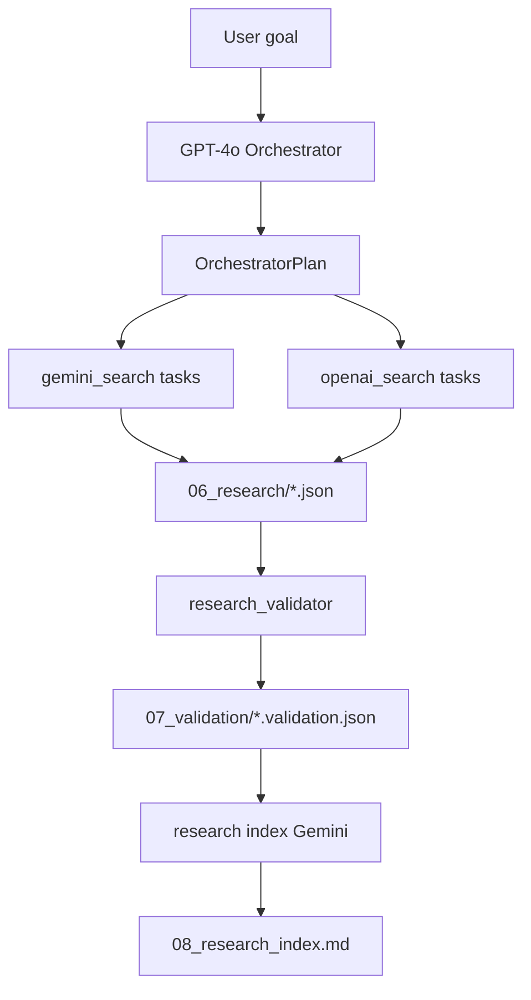

# Research flow

**Mission:** GPT-4o orchestrator → **gemini_search** + **openai_search** (one artifact per subtask) → **research_validator** → **research index** catalog.

(`claude_search` and `exa_search` are disabled in code; legacy plans skip those agents.)

**Package:** `research`  
**Source of truth:** `research/pipeline.py` → `ResearchPipeline.run()`

---

## Flow

| Agent id | Provider | Role |
|----------|----------|------|
| Orchestrator | OpenAI GPT-4o | Plan via **function calling** |
| `gemini_search` | Gemini | One JSON file per literature subtask |
| `openai_search` | OpenAI GPT-4o | One JSON file per methods/limitations subtask |
| `research_validator` | Gemini | Source traceability + clarity per task file |
| Research index | Gemini | Catalog: which file contains what |

---

## Artifacts (paper_input execution)

| Step | Path |
|------|------|
| 05 | `05_orchestrator_plan.json` |
| 06 | `06_research/<task>.json` + `manifest.json` + `06_gathered_research.json` (aggregate) |
| 07 | `07_validation/<task>.validation.json` + `manifest.json` |
| 08 | `08_research_index.md` |

Standalone runs use `02_research/`, `03_validation/`, `04_research_index.md` under `output/research_runs/run_NNN/`.

---

## Environment

| Provider | API key | Model variables |
|----------|---------|-----------------|
| OpenAI | `OPENAI_API_KEY` | `RESEARCH_ORCHESTRATOR_MODEL`, `RESEARCH_OPENAI_SEARCH_MODEL` |
| Google | `GOOGLE_API_KEY` | `RESEARCH_GEMINI_SEARCH_MODEL`, `RESEARCH_REPORT_SYNTHESIZER_MODEL` (validator + index) |

Active search agents: `research/config.py` → `ACTIVE_SEARCH_AGENT_IDS`.

---

## Changelog

| Version | Change |
|---------|--------|
| 1.5.0 | Per-task research files; validator; index catalog replaces merged synthesizer report |
| 1.4.0 | GPT-4o orchestrator + openai_search; claude/exa disabled |
| 1.2.0 | Three search agents + report_synthesizer |
