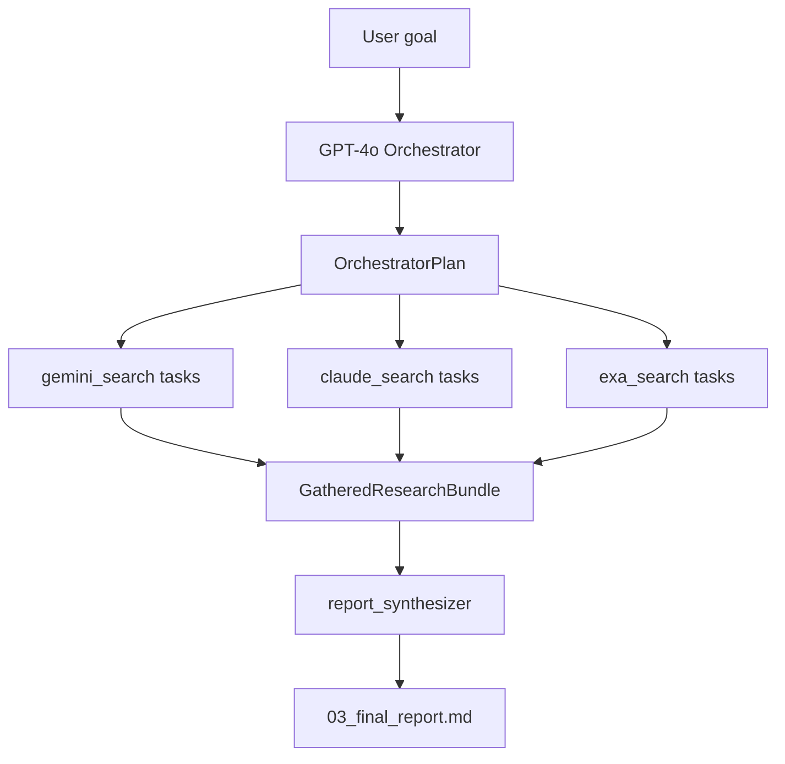

# Research flow

**Mission:** Multi-agent research — **three search agents in parallel** (Gemini, Claude, Exa), then a **report synthesizer** (Claude).

**Package:** `research`  
**Source of truth:** `research/pipeline.py` → `ResearchPipeline.run()`

---

## Flow



| Agent id | Provider | Role |
|----------|----------|------|
| `gemini_search` | Gemini | Subtopic research (model knowledge) |
| `claude_search` | Claude | Subtopic research (model knowledge) |
| `exa_search` | Exa API | Live web (`type=deep`, highlights) |
| `report_synthesizer` | Claude | Final Markdown report |

All search tasks run **in parallel** (`SearchCoordinator`).

---

## Entry points

```bash
research "Your research goal"
```

---

## Environment (per agent)

| Agent | API key | Model / options |
|-------|---------|-----------------|
| Orchestrator | `RESEARCH_ORCHESTRATOR_API_KEY` | `RESEARCH_ORCHESTRATOR_MODEL` |
| Gemini search | `RESEARCH_GEMINI_SEARCH_API_KEY` | `RESEARCH_GEMINI_SEARCH_MODEL` |
| Claude search | `RESEARCH_CLAUDE_SEARCH_API_KEY` | `RESEARCH_CLAUDE_SEARCH_MODEL` |
| Exa search | `RESEARCH_EXA_SEARCH_API_KEY` or `EXA_API_KEY` | `EXA_SEARCH_TYPE`, `EXA_NUM_RESULTS` |
| Report synthesizer | `RESEARCH_REPORT_SYNTHESIZER_API_KEY` | `RESEARCH_REPORT_SYNTHESIZER_MODEL` |

Legacy fallbacks: `RESEARCH_GATHERER_*`, `RESEARCH_ANALYST_*`, `GOOGLE_API_KEY`, `ANTHROPIC_API_KEY`.

Put secrets in `.env` only — do not commit API keys in `exa.txt`.

---

## Changelog

| Version | Change |
|---------|--------|
| 1.2.0 | Three search agents: gemini_search, claude_search, exa_search + report_synthesizer |
| 1.1.0 | AI-only gatherer (no web scrape) |
| 1.0.0 | Initial research package |
