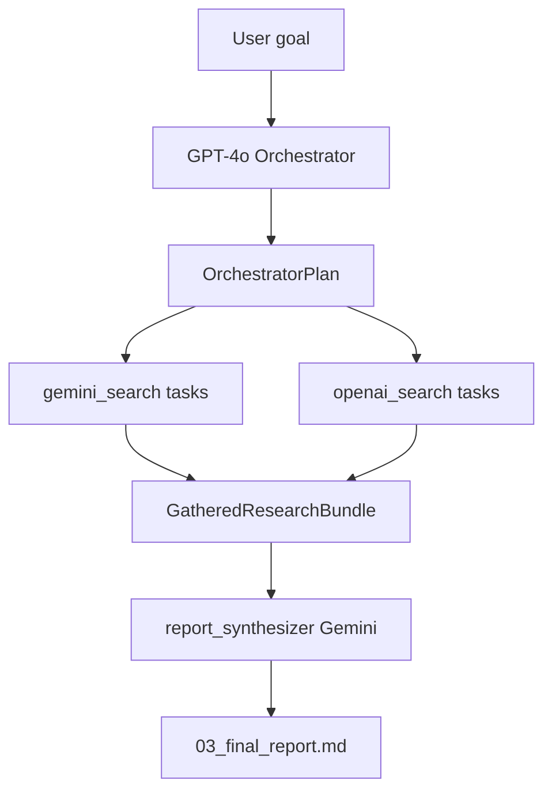

# Research flow

**Mission:** GPT-4o orchestrator → **gemini_search** + **openai_search** in parallel → Gemini **report_synthesizer**.

(`claude_search` and `exa_search` are disabled in code; legacy plans skip those agents.)

**Package:** `research`  
**Source of truth:** `research/pipeline.py` → `ResearchPipeline.run()`

---

## Flow

| Agent id | Provider | Role |
|----------|----------|------|
| Orchestrator | OpenAI GPT-4o | Plan via **function calling** (`research/prompts/openai_orchestrator/`) |
| `gemini_search` | Gemini | Background / literature |
| `openai_search` | OpenAI GPT-4o | Methods / limitations |
| `report_synthesizer` | Gemini | Final Markdown |

---

## Environment

| Provider | API key | Model variables |
|----------|---------|-----------------|
| OpenAI | `OPENAI_API_KEY` | `RESEARCH_ORCHESTRATOR_MODEL`, `RESEARCH_OPENAI_SEARCH_MODEL` |
| Google | `GOOGLE_API_KEY` | `RESEARCH_GEMINI_SEARCH_MODEL`, `RESEARCH_REPORT_SYNTHESIZER_MODEL` |

Active search agents: `research/config.py` → `ACTIVE_SEARCH_AGENT_IDS`.

---

## Changelog

| Version | Change |
|---------|--------|
| 1.4.0 | GPT-4o orchestrator + openai_search; claude/exa disabled |
| 1.3.0 | All-Gemini experiment |
| 1.2.0 | Three search agents + report_synthesizer |
